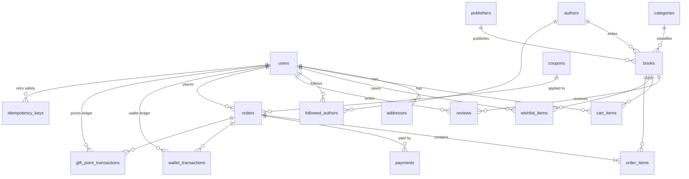

# Data model

PostgreSQL 16+ schema: [`database/schema.sql`](../database/schema.sql). Seed data (generated from the frontend mock catalogue): [`database/seed.sql`](../database/seed.sql).



17 tables in total.

## Subsystem mapping

| Subsystem (architecture diagram) | Tables |
| --- | --- |
| Member | `users`, `addresses`, `followed_authors`, `wishlist_items` |
| Catalog | `categories`, `authors`, `publishers`, `books`, `reviews` |
| Order | `cart_items`, `orders`, `order_items`, `coupons`, `gift_point_transactions` |
| Payment | `payments`, `wallet_transactions`, `idempotency_keys` |
| Shipping | `addresses`, `orders.shipping_address` (immutable snapshot); delivery date is derived from `books.format` |

## Design decisions

- **Order lifecycle:** `pending_payment → placed → delivered`, or `placed → cancelled`. `CHECK` constraints tie each status to its timestamp (`placed_at`, `delivered_at`, `cancelled_at`), so an order cannot be "placed" without a time. Unpaid orders expire after 30 minutes and become `cancelled` without ever having a `placed_at`, so a `cancelled` order may have a null `placed_at`; `pending_payment` orders never have one.
- **48-hour cancellation:** `orders.cancellable_until` is set to `placed_at + 48 hours` when payment succeeds. The API allows cancellation only while `status = 'placed'` and `now() < cancellable_until`.
- **Totals are verified by the database:** `total = subtotal + tax + delivery_charge − coupon_discount − points_discount`, and `points_discount = points_used` (1 point = 1 RON).
- **Retry safety:** `idempotency_keys` stores the response of each `POST /orders` and `POST /orders/{id}/payments` per user and key, so a retried request returns the original result instead of charging twice.
- **No sensitive payment data:** `payments` stores only the gateway reference (cash-on-delivery payments have none). Card numbers and CVVs never reach the API or the database.
- **No passwords:** users are identified by their OpenID Connect issuer and subject.
- **Ledgers:** `wallet_transactions` and `gift_point_transactions` are append-only. `users.wallet_balance` and `users.gift_points` are running totals (never negative) updated in the same transaction as the ledger row.
- **Snapshots:** `order_items.unit_price` / `book_title` and `orders.shipping_address` keep history stable when the catalogue or address book changes.
- **Stock:** `books.stock` is `NULL` for eBooks and required for physical formats (enforced by a `CHECK`).
- **Search:** `books.search_vector` (generated `tsvector` on title and subtitle) with a GIN index, plus a GIN index on `tags`.
- **"Buy It Again" and recommendations:** served by `order_items` joined to `orders` (index on `order_items.book_id`, `orders (user_id, created_at DESC)`).

## Loading locally

```bash
createdb bookworm
psql bookworm -v ON_ERROR_STOP=1 -f database/schema.sql -f database/seed.sql
# Regenerate the seed after changing the frontend mock data:
node database/generate-seed.mjs > database/seed.sql
```
